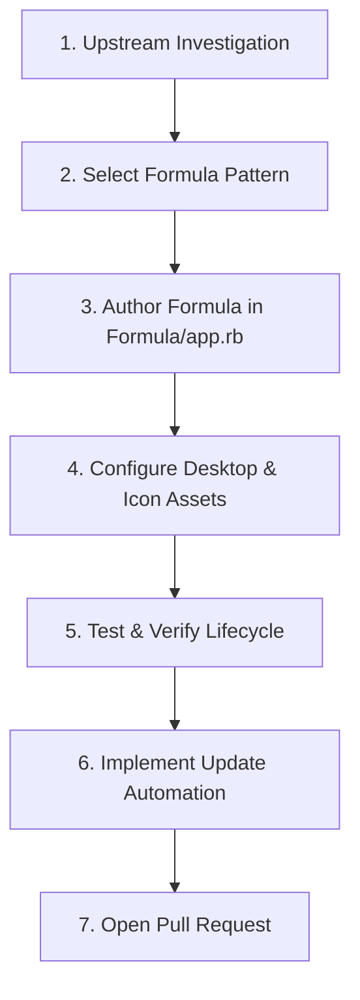

# Step-by-Step SOP: Adding a New Package

This Standard Operating Procedure (SOP) outlines the exact workflow for adding a new application to `fedora-brew`.

---

## Overview Workflow



---

## Step 1: Upstream Investigation

Before writing code, investigate the upstream distribution model and document:

1. **Artifact Format**:
   * Is it a tarball (`.tar.gz`, `.tar.xz`), AppImage (`.AppImage`), Debian archive (`.deb`), or raw binary?
2. **Release Source**:
   * Official GitHub releases (`github.com/org/repo/releases`)?
   * Cloud storage bucket or vendor CDN?
3. **Architecture Support**:
   * Does it support `x86_64` only, or both `x86_64` and `aarch64` (ARM64)?
4. **Self-Updater Mechanism**:
   * Does the application have an internal auto-updater (e.g., Electron `app-update.yml` or Sparkle)?
   * Can auto-updating be disabled via environment variable (e.g., `DISABLE_AUTO_UPDATE=1` or `--no-auto-update`)?
5. **Runtime Dependencies**:
   * Does it expect standard Linux desktop libraries (GTK3, NSS, ALSA, X11/Wayland)?

---

## Step 2: Select a Formula Pattern

Refer to [FORMULA_PATTERNS.md](FORMULA_PATTERNS.md) to choose the matching archetype:

* **Pattern A**: Vendor Tarball / Electron Application (like `antigravity.rb`)
* **Pattern B**: AppImage Payload
* **Pattern C**: Debian (`.deb`) Payload Extraction
* **Pattern D**: Standalone Prebuilt Binary

---

## Step 3: Author the Formula

Create `Formula/<package_name>.rb` (using lowercase, hyphenated names matching Homebrew naming conventions).

### Mandatory Elements:

1. **Header & Metadata**:
   ```ruby
   class Myapp < Formula
     desc "Short single-line description of the application"
     homepage "https://example.com"
     url "https://example.com/downloads/v1.0.0/myapp-linux-x64.tar.gz"
     sha256 "0123456789abcdef0123456789abcdef0123456789abcdef0123456789abcdef"
     license :cannot_represent # Or specific license, e.g. "MIT", "Apache-2.0"
   ```

2. **Architecture & OS Guards**:
   ```ruby
     depends_on :linux
     depends_on arch: :x86_64 # Or handle multiple archs with on_intel / on_arm blocks
   ```

3. **Livecheck Block**:
   ```ruby
     livecheck do
       url "https://example.com/downloads"
       regex(/myapp[._-]v?(\d+(?:\.\d+)+)[._-]linux/i)
     end
   ```

4. **Installation & Desktop Files**:
   * Place application payload into `libexec`.
   * Create executable wrapper in `bin/` using `write_env_script`.
   * Write standard `.desktop` file into `share/applications/`.
   * Install application icon into `share/icons/hicolor/<size>/apps/`.

5. **Static Test Block**:
   * Verify executable status and core files.
   * **Do NOT launch GUI windows** in `test do`.

---

## Step 4: Validate the Full Lifecycle

Run these validation commands locally:

### 1. Style & Syntax Validation
```bash
# Ruby syntax check
brew ruby -- -c Formula/myapp.rb

# Homebrew style (RuboCop)
brew style Brandon-Gottshall/fedora-brew/myapp

# Homebrew strict audit
brew audit --strict Brandon-Gottshall/fedora-brew/myapp
```

### 2. Lifecycle Testing
```bash
# Install
brew install --build-from-source Brandon-Gottshall/fedora-brew/myapp

# Run tests
brew test Brandon-Gottshall/fedora-brew/myapp

# Verify desktop entry validity
desktop-file-validate $(brew --prefix)/share/applications/myapp.desktop

# Test uninstall and reinstall
brew uninstall myapp
brew install Brandon-Gottshall/fedora-brew/myapp
```

### 3. Desktop Discovery Testing
Run the tap doctor to verify desktop launcher visibility:
```bash
scripts/doctor
```
Verify that the app appears in KDE Application Launcher, KRunner, and Vicinae.

---

## Step 5: Implement Update Automation

1. Create or update an update script in `scripts/` (e.g. `scripts/update-<package>.py`).
2. Add unit tests in `test/test_update_<package>.py`.
3. Add a GitHub Actions workflow in `.github/workflows/update-<package>.yml` that creates a PR upon detecting a new release.

---

## Step 6: PR Checklist

Before submitting your PR:
- [ ] Formula passes `brew audit --strict` with zero errors.
- [ ] Formula passes `brew style` with zero errors.
- [ ] `.desktop` file passes `desktop-file-validate`.
- [ ] Executable wrapper disables internal auto-updaters if applicable.
- [ ] Uses stable `opt_bin` in desktop entry `Exec=` path.
- [ ] `test do` passes without opening GUI windows.
- [ ] Automated tests in `test/` pass.
