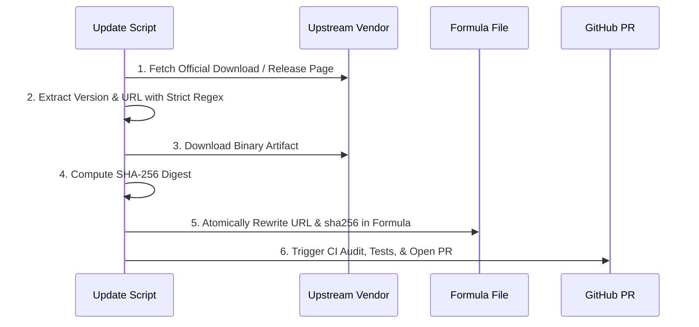

# Update Automation Guide

This document details the release discovery, checksum verification, and CI automation pipelines used in `fedora-brew`.

---

## 1. Principles of Safe Update Automation

Automated updates in `fedora-brew` must adhere to these rules:

1. **Strict Version Boundaries**: Scrapers must target specific product generations and reject legacy or malformed links (e.g. rejecting 1.x links for Antigravity).
2. **Deterministic Checksumming**: Formulas must never use unvalidated or dynamic checksum bypasses. The update pipeline downloads the immutable asset and computes a real SHA-256 hash.
3. **No Direct Pushes to Main**: Update bots must create a Pull Request containing the updated formula. CI executes the full test suite and strict audits before a maintainer merges.

---

## 2. Anatomy of an Update Script

An update script (such as `scripts/update-formula.py`) performs 5 key steps:



### Example Implementation Structure (Python):
```python
def update_formula(formula_path: Path, new_url: str, new_sha256: str) -> bool:
    content = formula_path.read_text()
    
    # Replace URL
    content, url_count = re.subn(r'  url ".*?"', f'  url "{new_url}"', content, count=1)
    # Replace sha256
    content, sha_count = re.subn(r'  sha256 "[0-9a-f]{64}"', f'  sha256 "{new_sha256}"', content, count=1)
    
    if (url_count, sha_count) != (1, 1):
        raise ValueError("Formula structure does not match expected format!")
        
    formula_path.write_text(content)
    return True
```

---

## 3. GitHub Actions PR Workflow

The updater runs automatically via GitHub Actions (e.g., `.github/workflows/update-antigravity.yml`).

### Workflow Responsibilities:
1. **Trigger Schedule**: Runs daily via `cron` or manually via `workflow_dispatch`.
2. **Environment Setup**: Configures Python, Homebrew, and tap repositories.
3. **Execution**: Runs the Python updater.
4. **Validation**: Executes `brew audit --strict` and the tap's unit test suite.
5. **PR Creation**: Uses `peter-evans/create-pull-request` to create or update a clean PR branch.

---

## 4. Livecheck Integration

Where possible, include a `livecheck` block in the formula so users can query the latest version via native Homebrew commands:

```bash
brew livecheck Brandon-Gottshall/fedora-brew/antigravity
```
